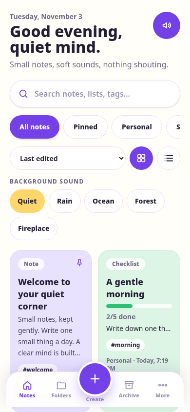

# Blobbo — Notes that stay quiet

Blobbo is a calm, minimal notes app with three ways to capture a thought: text notes, checklist notes, and sketch notes on dotted paper.

## What it does

- Text notes, checklist notes, and sketch notes with colours, pen sizes, eraser, and undo and redo on dotted paper.
- Folders, pinning, favourites, archive and trash with restore, tags, live search, and sorting.
- Stats, export all, and delete all.
- Soft synthesized sounds, SVG blob mascots, and a Reduce Motion setting.
- A 3-slide onboarding that explains the app before the first note.

## Status

Working prototype, built November 2026. Built to test whether a notes app that feels peaceful gets opened more often.

## Showcase only

This repository is a showcase. It contains no source code and no build files, and nothing here is open source. The screenshot(s) above are showcase images only. See NOTICE.md.

## Contact

Built by Yash Dashrath, Pune, India.

- Email: yashdashrath18@gmail.com
- LinkedIn: https://www.linkedin.com/in/yash-dashrath
- Yash MediaWorks: https://www.linkedin.com/company/yashmediaworks/
